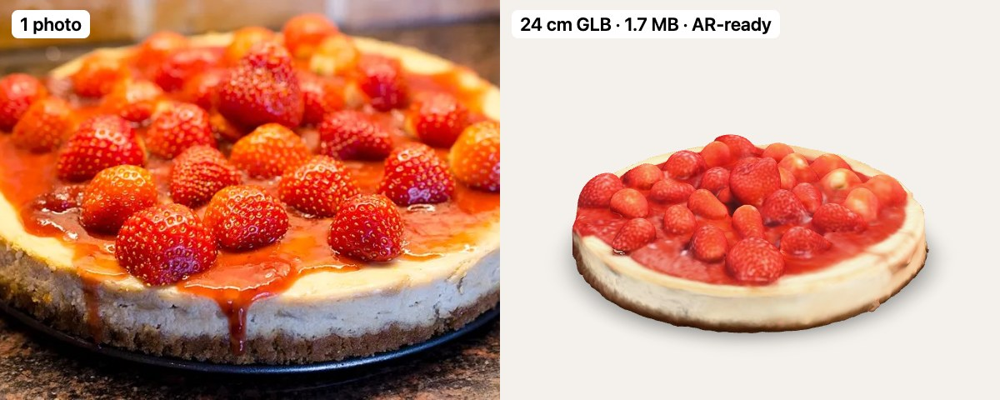

# photo-to-3d: one product photo to a real-size 3D model and AR

**Turn a single photo of a product into a small, real-size 3D file (GLB) that works in a web page and in
augmented reality ("see it on your table").** Free, open source, runs on your own Mac or on a free cloud GPU.
No 3D skills, no scanning, no subscription.



Made for small shops: bakeries, cafes, florists, jewellers, anything you sell as a physical object.
The output is a normal `.glb` file, so it works with Google `<model-viewer>`, three.js, Babylon.js, Blender,
Android Scene Viewer, WebXR and Apple Quick Look (after converting to USDZ).

## Quick start

```bash
git clone https://github.com/IFAKA/photo-to-3d && cd photo-to-3d

# A) Free cloud GPU (Hugging Face), about 2-4 minutes, needs python3 + blender
./photo3d examples/cheesecake-input.jpg cheesecake.glb 24 --plug -0.012,0.44
#          photo                         output         width in cm

# B) Fully on your Mac, no quota, about 1.5 minutes per photo (see "Local run" below)
export TRELLIS_MAC=/path/to/trellis-mac
./photo3d-local examples/cheesecake-input.jpg cheesecake.glb 24
```

Needs `python3` and `blender` on your PATH. The first run creates its own virtual environment.
Then drop `cheesecake.glb` into your site and show it:

```html
<script type="module" src="https://ajax.googleapis.com/ajax/libs/model-viewer/4.0.0/model-viewer.min.js"></script>
<model-viewer src="cheesecake.glb" ar ar-modes="webxr scene-viewer quick-look" ar-scale="fixed"
              camera-controls auto-rotate></model-viewer>
```

## What you get

| | |
|---|---|
| Real size | The width you give (in cm) is the width in AR. `ar-scale="fixed"` keeps it true. |
| Small | About 1.7 MB: 50k faces, 1024 px JPEG texture. Loads fast on mobile data. |
| Clean colours | Metallic is forced to 0 (the AI often makes food look like metal). |
| Open licences | TRELLIS.2 (MIT), BiRefNet (MIT). No non-commercial models in the chain. |

## How it works

1. **Photo to 3D** with [TRELLIS.2](https://github.com/microsoft/TRELLIS.2) (image-to-3D AI, MIT licence),
   in the cloud (`scripts/cloud.py`) or on your Mac with
   [trellis-mac](https://github.com/shivampkumar/trellis-mac) (`photo3d-local`).
2. **Plug (cloud path only)** (`scripts/plug.py`): generated cakes are hollow and show dark cracks. A hidden disc
   under the top surface, in the top colour, hides them.
3. **Real size** (`scripts/set_width.py`): scale so the width equals your real width in cm.
4. **Shrink** to a viewing budget (Blender): a smaller file with the same look.

## How much detail? (do not ship pixels nobody can see)

More detail than the eye can see only costs download time. Measured on a 24 cm cheesecake:

| faces / texture | file | look |
|---|---|---|
| 73k / 2048 px | 4.0 MB | clean, even very close |
| **50k / 1024 px (default)** | 1.7-2.4 MB | clean at AR distance |
| 30k / 1024 px | 1.7 MB | shards on the fruit when close |
| 20k / 1024 px, 15k / 512 px | 1.2 / 0.9 MB | too rough for AR |

A product sheet on a phone shows the model about 420 px wide. In AR on a 1440 px phone it is about 600 px
(50 cm away) to 1000 px (30 cm). A 1024 px texture already matches that, so 2048 px is wasted.
Change it with `--faces N --tex PX`. A flat product like a box can use fewer faces.

## Local run (no cloud quota)

`photo3d-local PHOTO OUT.glb WIDTH_CM` does everything on an Apple Silicon Mac (24 GB RAM or more recommended).
About 1-2 minutes per photo (use `./photo3d-batch LIST OUTDIR` for many photos: the AI models load once, 6 sampling steps instead of 12, Blender runs while the next photo generates). With 12 steps (`photo3d-local`) it takes 3-5 minutes. No plug needed, and the result is smoother than the
cloud one.

Setup (once):
1. `git clone https://github.com/shivampkumar/trellis-mac && cd trellis-mac && SKIP_METAL=1 bash setup.sh`
   (about 16 GB of weights). Accept the gated `facebook/dinov3-vitl16-pretrain-lvd1689m` model on Hugging Face.
2. `uv pip install -p .venv/bin/python einops`
3. Apply `local/trellis-mac.patch` to `generate.py`.
4. In `TRELLIS.2/trellis2/pipelines/rembg/BiRefNet.py` make `to()` do `self.model.to(device).float()`.
5. In `trellis2_image_to_3d.py` use `rembg.BiRefNet(model_name='ZhengPeng7/BiRefNet')` (MIT) instead of
   RMBG-2.0 (non-commercial).
6. `export TRELLIS_MAC=/path/to/trellis-mac`

Three bugs found on the way, fixed in the patch and scripts:
1. The mesh from trellis-mac is wound inside-out. It looks like shards until you flip the faces.
2. Its own UV unwrap (xatlas) breaks the mesh into thousands of tiny pieces. We skip it: colour the vertices from
   the voxels (`local_color.py`), then Blender makes a clean low copy and bakes the colour onto it (`bl_local.py`).
3. Blender's voxel remesh makes quads, so "55k faces" was really 110k triangles. Triangulate first, and use smooth
   shading, or every triangle gets its own 3 vertices and the file is 3x bigger.

Do not run `bl_shrink.py` on the local result: it breaks the texture. `photo3d-local` does not use it.

## Tips and facts

- **Use a photo of the whole product**, from the front and slightly above. A slice or a plate gives a wrong model.
- Only the width is real. The height is the AI's guess from the photo.
- Do not decimate with trimesh: it scrambles the UVs and the colours. Use Blender.
- AR on Android: WebXR in Chrome over **https** works. Scene Viewer (the Google app) crashed on a Galaxy S10.
  ngrok free adds a warning page that blocks the model file; a Cloudflare quick tunnel does not.
- Hands in front of the model (occlusion) needs a phone with real depth sensing.

## Speed notes (measured on an M-series Mac)

- Use 6 sampling steps (default in `photo3d-batch`): about 2.5x faster than 12 with the same look. 4 steps breaks the model.
- Blender step: about 8 s. Decimate the raw mesh first, then clean holes on the small mesh. Cleaning the full mesh first took 50 s.
- 50k faces and a 1024 px texture are the floor: 20k faces with a 512 px texture shatters the cream on the test cake.
- Load the AI models once (`photo3d-batch`) and let Blender run while the next photo generates.

## FAQ

**Can I make a 3D model from one photo?** Yes. Modern image-to-3D AI (TRELLIS.2) guesses the back and the height
from a single photo. Expect a good shape and colour, not a measured scan.

**Is it free?** Yes. The cloud path uses the free Hugging Face quota (about 2 GPU minutes per run, daily). The
local path uses only your Mac.

**Does it work for AR on iPhone?** The GLB works on Android and in browsers. For iPhone Quick Look, convert the
GLB to USDZ (for example with Blender or `usdzconvert`).

**What licence is the output?** The tool is MIT. Your model belongs to you, as far as the photo is yours. The
example photo is CC BY-SA 4.0, see `examples/ATTRIBUTION.md`.

## Keywords

photo to 3d, image to 3d, single image 3d reconstruction, product photo to GLB, 3D product viewer, AR try on your
table, WebXR, model-viewer, TRELLIS.2, ecommerce 3D, food 3D model, bakery AR menu, Blender automation.

## Licence

MIT, see `LICENSE`. Example photo: CC BY-SA 4.0 (`examples/ATTRIBUTION.md`).
